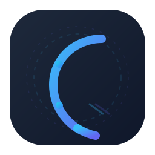

> 🌐 English Version：[🇬🇧 README_EN](./README_EN.md)
<div align="center">
  
  <h1>CodeCraft 🛠️</h1>
   <p><strong>多 LLM 驱动的 AI 编程 Agent · 终端级代码助手 · 自然语言开发工具</strong></p>
  <p>
    AI Coding Agent | AI Pair Programming | Autonomous Coding Assistant | Multi-LLM DevTool<br>
    支持多种大语言模型（DeepSeek / GPT / OpenAI 兼容 / Anthropic / 通义千问 / 火山方舟 / Ollama / MiMo / MiniMax）的智能体编程助手——自然语言对话，自动读写文件、搜索代码、执行命令、管理 Git，复杂任务自动拆解并行执行
  </p>

  <p>
    
    
    
    
    
    
    
    
    
  </p>
</div>

---

> 📦 **前端说明**：仓库内并存两套前端 —— `frontend/`（经典版，服务在 `/`）与
> `frontend-v3/`（新版，服务在 `/v3/`，默认入口）。构建、版本切换、localStorage
> 键划分、Electron 适配等部署细节见 **[frontend-v3/MIGRATION.md](./frontend-v3/MIGRATION.md)**。
> 一句话发版：`scripts\pack-v3.bat` → 重启后端。

## 🏷️ 关键词 / Topics

`ai-coding-assistant` `coding-agent` `ai-agent` `deepseek` `openai` `gpt` `anthropic` `qwen` `volcengine` `ollama` `mimo` `minimax` `multi-llm` `llm` `large-language-model` `vibe-coding` `developer-tools` `cli-tool` `terminal` `ai-pair-programming` `autonomous-agents` `multi-agent` `task-decomposition` `code-generation` `agentic-ai` `open-source` `ai-assisted-development` `coding-assistant` `git-automation` `ai-software-engineer` `agent-framework` `self-hosted` `natural-language-programming` `ai-code-editor`

> 💡 **搜这些词都能找到 CodeCraft！** 以上是 GitHub 上同类 AI 编程助手（Cline / Aider / OpenCode / Codex / Cursor 等）用户最常用的搜索关键词，已全部覆盖。

---

## 📖 项目简介

**CodeCraft** 是一个支持**多种大语言模型（DeepSeek / GPT / OpenAI 兼容 / Anthropic / 通义千问 / 火山方舟 / Ollama / MiMo / MiniMax 等）** 的 **AI 编程 Agent（AI Coding Agent / AI Pair Programming Tool）**，以桌面应用 + 终端命令行的形态，将自然语言对话转化为生产力级的自动化编程操作。通过统一的 LLMClient 抽象层，用户可在运行时动态切换不同 LLM Provider，每个 Agent 也可绑定特定的 Provider 和模型。

与普通的 AI ChatBot 聊天助手不同，CodeCraft 是一个真正具备**完整工具调用能力（Tool Use / Function Calling）** 的 **Autonomous Coding Agent（自主编程智能体）**——它能读取项目文件、搜索代码库、执行 Shell 命令、操作 Git 版本控制，甚至自动创建子 Agent 并行处理复杂开发任务，像一位 **AI 软件工程师（AI Software Engineer）** 一样独立完成工作。

## ✨ 核心功能

### 🧠 多 Agent 并行协作（Multi-Agent System）
可创建不同角色的 AI Agent（Coding Agent、Code Reviewer、Software Architect 等），每个 Agent 独立配置系统提示词（System Prompt）、工具集和模型参数。主 Agent 执行复杂任务时，自动进行 **Task Decomposition（任务拆解）**，召唤多个子 Agent 后台并行执行，最多 20 个并发协作——典型的多 Agent 框架（Multi-Agent Framework）架构。

### 🤝 智能体互相调用（Agent-to-Agent Invocation）
Agent 之间可**任务委托**：智能体 A 在执行中通过 `agent_invoke` 工具调用智能体 B，B 以自身身份（自己的角色/模型/工作目录/工具集）在**独立会话**中执行——支持 `create_session`（为 B 新建会话）与 `continue_session`（按会话 ID 让 B 带着历史继续干）。**委托即授权**：用户批准一次委托后，B 执行期间免弹窗（信任沿调用链传递，环检测 + 深度 ≤3 防死循环）；A 停止任务会级联取消 B 的委托任务。B 的委托会话会出现在其会话列表（名称带「[A 委托]」前缀），透明可审计。详见 `docs/AGENT_INVOKE_DESIGN.md`。

### 🌐 多 LLM Provider 支持（Multi-LLM Platform）
支持 **10 类 Provider 模板**：DeepSeek、GPT（OpenAI 官方专精）、OpenAI（公共契约）、Anthropic（公共契约）、通义千问（阿里云百炼）、火山方舟（豆包）、Ollama、MiMo、MiniMax、自定义。

其中 **OpenAI / Anthropic 是「公共契约」模板**——任何符合对应协议规范的服务（Azure、OpenRouter、各类中转站、vLLM / LM Studio / One-API 自建网关、GLM / DeepSeek / MiniMax 的 `/anthropic` 兼容层）都能直接接入，且会自动做协议转换（Anthropic 图片块 `image_url → image/source`、工具格式转换）；而 **GPT / DeepSeek / 火山方舟 / 通义千问** 等专用模板则启用各家专有参数（思考档位 `reasoning_effort` / `thinking.type` / `enable_thinking`、`max_completion_tokens`、图片理解、联网搜索等）。

通过统一的 LLMClient 抽象层屏蔽不同平台的 API 差异，前端运行时可随时切换 Provider，无需重启服务；每个 Agent 可绑定特定 Provider 与模型，配置变更自动热刷新。平台增强能力按「按需启用 + 缺凭证自动跳过 + 失败自动回退」策略工作：搜索侧支持 DeepSeek 官方搜索、火山方舟联网搜索、MiniMax 搜索；余额/额度侧支持 DeepSeek、火山引擎（AK/SK）、通义千问（阿里云 AK/SK）、MiniMax（套餐额度）与 MiMo（控制台 Cookie）。详见 [LLM Provider 系统文档](docs/LLM_PROVIDER_SYSTEM.md)。

### 🛡️ 三层安全防护（Human-in-the-Loop）
工具执行采用渐进式安全策略：Manual 模式下数据操作和路径敏感操作弹窗授权，Auto 模式下高危工具（file_writer action=delete / execute_sql 等）仍需人工确认。支持"本轮对话全部同意"一键放行，在 Autonomous Agent 自动化和 Human-in-the-Loop 人工管控之间取得最佳平衡。

### 📸 代码快照回滚（Snapshot / Undo System）
AI 修改文件前自动创建快照备份，支持按消息、按文件、按会话三种粒度回滚，500MB 配额自动清理。类似 Aider 的 undo 机制，但更细粒度。

### 🧩 智能技能系统（Agent Skills / Plugin System）
将常用操作流程封装为可复用技能（名称 + 触发词 + 执行步骤），以「渐进式披露」两级结构供 AI 使用：全量技能的轻量目录（名称 / 置信度 / 触发词 / 一句话描述）动态注入 System Prompt 保持全局视野，完整执行说明由 AI 按需加载——不占上下文窗口、长对话开销恒定，贝叶斯置信度动态调整确保越用越精准。类似 Claude Code 的 custom commands / Codex 的 skills 机制。

### 📚 成长体系（踩坑经验库 / Lesson Knowledge Base）
AI 执行任务踩过的坑自动沉淀为**经验库**（按项目隔离、按需检索、零上下文开销）：工具失败自动捕获草稿、对话级异步复盘提炼解法；再次遇到相同错误时自动向 AI 注入「解法提示 + 补全引导」；**反馈验证闭环**驱动经验转正/隐藏（有效复用 2 次转正、连续失败 5 次隐藏），越用越聪明。前端提供「踩坑经验」管理页（/lesson-manage）与成长看板统计。

### ⏰ 定时任务（Scheduled / Cron Job）
支持一次性任务和 Cron 周期任务，可绑定指定 Agent 自动执行，每次执行生成独立会话追溯。实现 Agentic Workflow（智能工作流）自动化。

### 🖥️ 内置代码编辑器（Built-in Code Editor）
基于 highlight.js 的自研编辑器，支持 30+ 语言语法高亮、行号、暗色主题、光标定位、dirty 标记和快捷键保存。

### 🎨 智能 Markdown 渲染与「应用内查看」
支持 KaTeX 数学公式、命令终端卡片、文件清单卡片、彩色提示容器、XSS 安全防护；AI 回复中的项目文件路径、图片与外链可直接点击，在应用内以标签页打开（文件 / 图片 / 内嵌网页，支持系统浏览器打开，可随时关闭）——无需复制路径、无需离开应用。

### 💬 长会话渲染（分页懒加载 / 虚拟列表）
聊天记录按「轮」游标分页懒加载（首屏最近 5 轮，上滑到顶自动加载更早 5 轮），配合虚拟列表与高度自愈机制（`ResizeObserver` + 节流 `forceUpdate`）：即便上千条消息、含代码块 / 图片 / 折叠卡片的超长会话，也不会出现气泡重叠、位置错乱或滚动条乱跳，打开会话秒开。

### 🖌️ 个性化外观（背景图 / 窗口透明度）
侧边栏「外观设置」支持上传全局背景图（≤10MB），配合背景不透明度 / 背景模糊 / 窗口整体透明度三个滑块调出专属氛围；桌面端标题栏与整个窗口同步半透明，深浅主题皆宜。

### 👥 用户管理与权限（Multi-User / RBAC）
完整的账户体系：注册登录、Token 鉴权（JWT）、角色权限控制（RBAC）、菜单可见性管理、初始管理员自动创建。

### 🧰 27 个工具生态（Tool Use / Function Calling）
文件操作、命令执行、网络请求、数据库查询、Git 版本控制、Agent 协作、技能与经验管理、桌面自动化（Computer Use）等 9 大类 27 个工具全部对 AI 开放——覆盖 Software Engineering 日常开发全流程。网络类工具具备多搜索源优先级、结果缓存、反爬重试与代理自适应（自动探测 Clash / v2rayN 等本机代理），DeepSeek 官方 Provider 下自动使用官方搜索/抓取接口。

### 🖼️ 图像理解与文件管理（Vision / Files API）
支持在聊天中粘贴（Ctrl+V）或上传图片（≤64MB），经云端 **Files API**（file_id 引用）供 LLM 图像理解，适配器架构兼容 DeepSeek / Anthropic 双风格；内置独立**文件管理页**（上传/列表/重命名/删除/引用到会话，文件永久保存）；文档附件（PDF/Word/Excel/文本）本地统一纳管（storage_type 区分 cloud/local）。

### 🪟 桌面自动化（Computer Use）
AI 可"看到"并"操控"电脑：`screen_capture` 一键截屏（分辨率标准化 + 自动上传 + 注入上下文，叠加网格与刻度辅助坐标读数）→ `desktop_control` 键鼠模拟（点击/拖拽/滚轮/按键/输入，单次支持 1~20 个批量动作）——"截图 → 定坐标 → 操作 → 再截图验证"闭环。DESKTOP 高危权限管控 + 坐标准星预检（先验证后执行），支持 Windows / macOS / Linux。

### 🗄️ 数据管理（外部数据库连接 / 备份恢复）
在「数据库连接」管理页配置 MySQL / PostgreSQL / H2 外部业务库（密码 AES-256-GCM 加密存储、支持测试连接、内置「执行 SQL」工具可直接查改数据），AI 即可通过 `execute_sql` 的 `connection` 参数直接查询外部业务库——不传 `connection` 时仍连 CodeCraft 系统库，向后兼容。「数据管理」页支持配置数据一键导出备份 / 导入恢复（LLM 配置、智能体、技能、聊天记录、踩坑经验等 7 类数据），重装或跨设备迁移不再从头配置。

### 🛰️ MCP 生态接入（Model Context Protocol）
**双向 MCP 支持**：作为 Client 连接外部 MCP Server（GitHub、数据库、浏览器自动化等），外部工具动态注册进工具池供 AI 调用（支持 http/stdio 双传输、工具名前缀防冲突、权限档位映射）；作为 Server 对外暴露内置工具，供 Claude Desktop / Cursor 等客户端连接。前端提供「MCP 服务器」管理页（连接/断开/刷新/状态监控）。详见 `docs/MCP_SYSTEM.md`。

### 🧠 智能上下文压缩（Context Window Management）
三级渐进式压缩策略（预警→压缩→丢弃），LLM 摘要 + 保护带机制 + 异步预压缩，确保超长对话不超 Token 限制、不崩溃。

### 🔗 P2P 远程协作（Peer-to-Peer Remote）
基于 Netty + TLS 的点对点安全通道，可将 Agent 授权给远程伙伴调用。支持二维码配对、IPv6 直连、端到端加密、图片/文件传输。

### 🔄 应用内自动更新（Auto Update）
桌面端启动 15 秒后自动检查 GitHub Releases（6 小时缓存，规避 API 限流），发现新版本弹出通知。v3 新增**独立「版本与更新」页**（`/about`，设置页可进）：客户端版本与后端版本分列展示（只换 jar 不重装客户端时能一眼看出不一致）、Release 说明按 markdown 渲染、带进度条下载、一键安装（Windows 启动安装器并自动重启；macOS 打开 dmg 引导拖拽；Linux 定位安装包），下载支持镜像加速与失败自动回退直连，「自动检查 / 镜像前缀 / 备份保留份数」可配；浏览器环境自动降级为只读版本卡片并给出「请到 Releases 手动下载」提示。**升级不丢数据**：后端工作目录已迁至 `userData/runtime`（安装器不触碰），升级前自动备份数据库，安装包首次升级也会备份旧数据目录。

### 💾 开箱即用（Zero Config / Portable）
Electron 桌面应用，内置 JRE + Node.js + H2 嵌入式数据库，下载安装即用，零配置。支持 Windows / macOS / Linux 三平台。

---

## 🏗️ 技术栈

| 层级 | 技术 | 版本 |
|------|------|------|
| **AI 大模型** | **DeepSeek / OpenAI / Anthropic / Ollama / MiMo / MiniMax**（统一 LLMClient 抽象层） | - |
| **后端** | Java + Spring Boot | 17+ / 3.4 |
| **前端** | Vue 3 + TypeScript + Vite | 3.5 / 5.x / 6.x |
| **桌面壳** | Electron | 33 |
| **数据库** | H2 (嵌入式) + Caffeine (缓存) | 2.2+ / 3.1+ |
| **构建** | Maven + npm | 3.8+ / 10+ |

---

## 🚀 快速开始

### 💾 下载安装（普通用户）

不想搭建开发环境？直接下载已打包好的安装包：

- 前往 **[GitHub Releases 页面](https://github.com/zb614433612/CodeCraft/releases)** 
- Windows 用户下载 `CodeCraft-Setup-x.x.x.exe`
- macOS 用户下载 `CodeCraft-x.x.x.dmg`
- Linux 用户下载 `CodeCraft-x.x.x.AppImage`
- 双击安装即可使用，**无需安装 Java**（JRE 已内置在安装包中）
- 已安装用户无需手动重装：应用启动后会自动检查更新，也可在「数据管理 → 版本与更新」中手动检查并**一键升级**（升级会自动备份并保留全部本地数据）

> 安装后启动，后端服务自动运行（等待约 10~30 秒，启动画面实时展示进度），然后自动打开主界面。
> 首次使用请先到「模型配置」页面添加 **LLM Provider**（支持 DeepSeek / OpenAI / Anthropic / Ollama / MiMo / MiniMax 等）。

---

### 环境要求（开发者）

| 依赖 | 版本 | 说明 |
|------|------|------|
| Java | 17+ (JDK) | 构建时需要 `JAVA_HOME`，运行时无需安装 |
| Maven | 3.8+ | 后端构建 |
| Node.js | 20+ | 前端和 Electron 构建 |
| npm | 10+ | 随 Node.js 安装 |

### 开发模式运行

```bash
# 1️⃣ 构建后端（自动编译前端）
mvn clean package -DskipTests

# 2️⃣ 启动后端服务
mvn spring-boot:run

# 3️⃣ 访问 http://localhost:8084
```

### 单独启动前端（热更新）

```bash
cd frontend
npm install
npm run dev
```

### 启动 Electron 桌面应用

```bash
cd electron
npm install
npm start
```

> 详细构建和运行指南请参见 [BUILD_AND_RUN.md](BUILD_AND_RUN.md)

---

## 📂 项目结构

```
codecraft/
├── src/                          # Java 后端源码（Spring Boot）
│   ├── main/java/                # 主代码
│   │   └── com/example/agentdeepseek/
│   │       ├── common/           # 通用枚举、响应封装
│   │       ├── config/           # 配置类
│   │       ├── controller/       # REST API 控制器（含 LLM Provider、工具注册表等 API）
│   │       ├── filter/           # 过滤器（Token 鉴权）
│   │       ├── mapper/           # MyBatis 数据访问层
│   │       ├── model/            # DTO、实体（含 ProviderConfig）、VO
│   │       ├── scheduler/        # 定时任务
│   │       ├── service/          # 业务逻辑层
│   │       │   ├── llm/          # LLM 客户端层（LLMClient 接口 + 6 个 Provider 实现）
│   │       │   ├── lesson/       # 成长体系（经验库：检索/记录/复盘/失败归一化）
│   │       │   ├── agentinvoke/  # 智能体互调（委托执行/信任链）
│   │       │   ├── dbconnection/ # 外部数据库连接（配置/加密/连接管理）
│   │       │   └── files/        # 文件资产（Files API 适配/上传/图像理解）
│   │       ├── tool/             # AI Agent 工具（27 个工具）
│   │       │   ├── impl/         # 工具实现
│   │       │   ├── permission/   # 工具权限控制
│   │       │   └── postedit/     # 工具后处理（格式化、检查）
│   │       └── util/             # 工具类
│   └── main/resources/           # 配置文件和静态资源
├── frontend/                     # Vue3 前端源码
│   ├── src/
│   │   ├── api/                  # 后端 API 调用（agent-config, chat, conversation, skill, tools 等）
│   │   ├── components/           # 组件（AgentSelector, SkillList, FileTree 等）
│   │   ├── views/                # 页面（CodeAssistantView, AgentConfigView, SkillManageView 等）
│   │   ├── store/                # 状态管理
│   │   └── utils/                # 工具函数
│   └── public/                   # 静态资源
├── electron/                     # Electron 桌面壳
│   ├── main.js                   # Electron 主进程（启动画面 / 透明标题栏 / 窗口透明度）
│   ├── loading.html              # 启动画面（进度条 + 启动日志锚点）
│   ├── update-manager.js         # 自动更新（GitHub Releases 检测 / 下载 / 安装 / 升级前备份）
│   ├── update-utils.js           # 版本比较与发布资产匹配（可单测）
│   ├── installer.nsh             # NSIS 安装脚本扩展（首次升级备份旧数据目录）
│   ├── package.json              # Electron 配置
│   └── start.sh / start.bat     # 启动脚本
├── pom.xml                       # Maven 构建配置
├── scripts/                      # 自动化脚本（版本同步 / 一键构建）
├── .github/workflows/            # GitHub Actions CI（自动发布）
├── BUILD_AND_RUN.md              # 构建与运行指南
├── CHANGELOG.md                   # 版本更新日志
├── .gitignore                    # Git 忽略规则
└── application-local.yml.example # 本地覆盖配置模板（API Key 请用页面「Provider 配置」添加）
```

---

## 📚 文档导航

想深入了解 CodeCraft 的架构和开发细节？查看 [docs/](docs/) 目录：

| 文档 | 适合谁 | 说明 |
|------|--------|------|
| [架构全景图](docs/ARCHITECTURE.md) | 新人 / AI 协作 | 5 分钟建立全局认知 |
| [工具系统](docs/TOOL_SYSTEM.md) | 开发者 | 如何新增一个 AI Tool |
| [LLM Provider 系统](docs/LLM_PROVIDER_SYSTEM.md) | 开发者 | 多 LLM 平台支持、Provider 路由、扩展指南 |
| [核心引擎](docs/DEEPSEEK_SERVICE_IMPL.md) | 资深开发者 | Tool Loop 状态机 + 方法调用拓扑 |
| [P2P 协作](docs/P2P_SYSTEM.md) | 开发者 | 远程 Agent 调用全链路 |
| [快照系统](docs/SNAPSHOT_SYSTEM.md) | 开发者 | 代码备份与回滚机制 |
| [开发速查](docs/DEV_QUICKREF.md) | 日常开发 | 常用命令 / 端口 / 账号 |
| [发布清单](docs/RELEASE_CHECKLIST.md) | 维护者 | 打包发布 step-by-step |
| [常见问题](docs/FAQ.md) | 所有人 | 16 条已踩坑 FAQ |

---

## 🤝 贡献指南

欢迎贡献代码、报告 Bug 或提出新功能建议！请参见 [CONTRIBUTING.md](CONTRIBUTING.md)。

---

## 📄 开源许可

本项目基于 [MIT License](LICENSE) 开源。

---

## 🙏 致谢

- [DeepSeek](https://deepseek.com/) — 强大的大语言模型（LLM），驱动 CodeCraft 的核心智能
- [OpenAI](https://openai.com/) — GPT 系列模型，AI 领域的先驱
- [Anthropic](https://www.anthropic.com/) — Claude 系列模型，安全可靠的 AI 助手
- [Ollama](https://ollama.com/) — 本地 LLM 运行平台，让大模型触手可及
- [MiniMax](https://api.minimaxi.com/) — MiniMax 系列模型（M3 旗舰 / M2.x 系列），1M 上下文 + adaptive thinking
- [Spring Boot](https://spring.io/projects/spring-boot) — 后端框架
- [Vue.js](https://vuejs.org/) — 前端框架
- [Electron](https://www.electronjs.org/) — 跨平台桌面应用框架
